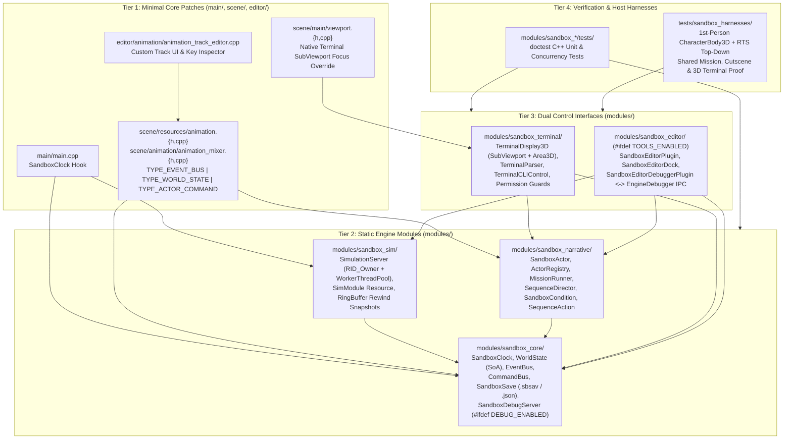

# Technical Review & Implementation Scope: Modular 3D Sandbox Engine Framework

## 1. Cross-Reference Review: Gemini Capabilities Report vs. `SPEC.md` vs. Local Codebase

We reviewed the shared **Godot Engine 4 Systems Capabilities Review** (`https://gemini.google.com/share/7c0a7ae265e0`), [SPEC.md](./SPEC.md), and the local engine source tree.

### 1.1 Alignment with the Gemini Systems Capabilities Review
[SPEC.md](./SPEC.md) directly addresses every structural boundary identified in the capabilities review:

| Capabilities Review Constraint | `SPEC.md` Architectural Resolution | Codebase Verification Status |
| :--- | :--- | :--- |
| **`Engine.time_scale` & Jolt Determinism (§3)** | Decouples `SandboxClock` (`sim_clock`, `physics_clock`, `narrative_ui_clock`) in `main/main.cpp`; restricts deterministic state to `SimulationServer`. | Verified in `main/main.cpp` and `main/main_timer_sync.h`. |
| **GDExtension `ClassDB` Ceiling & Singleton Quirks (§4)** | Implements core subsystems as static C++ modules (`modules/sandbox_*/`) with native lifecycle hooks and internal header access. | Verified in `modules/SCsub` and `modules/register_module_types.h`. |
| **`SceneTree` Single-Threaded Constraint & `WorkerThreadPool` Rules (§5)** | Uses Server Pattern (`SimulationServer`) with `RID_Alloc<T, true>` and enforces the 4 `WorkerThreadPool` invariants. | Verified in `core/templates/rid_owner.h` and `core/object/worker_thread_pool.h`. |
| **`AnimationTrackEditor` Unexposed to `ClassDB` (§6)** | Patches `Animation::TrackType`, `AnimationMixer`, and `AnimationTrackEditor` in C++ while pairing with `SequenceDirector` (`Tween.tween_await()`). | Verified in `scene/resources/animation.h`, `scene/animation/animation_mixer.cpp`, `editor/animation/animation_track_editor.cpp`, and `scene/animation/tween.h`. |
| **Diegetic 3D `SubViewport` Rendering & Input Traps (§7)** | Enforces `disable_3d = true`, MSDF fonts, min 256×256 FSR2 guard, no `SubViewportContainer`, camera-center raycast in captured mode, and native `Viewport` focus routing. | Verified in `scene/main/viewport.h` and `scene/main/viewport.cpp`. |
| **4.6+ `EditorDock`, `EditorDebuggerPlugin` IPC, & Security (§8)** | Uses `EditorDock` (`EditorPlugin::add_dock`), bidirectional `sandbox:*` debugger messages, primitive-only `.sbsav`/`.json` saves (`allow_objects = false`), and CSWSH/DNS-rebinding guards under `#ifdef DEBUG_ENABLED`. | Verified in `editor/docks/editor_dock.h`, `editor/plugins/editor_plugin.h`, `editor/debugger/editor_debugger_plugin.h`, and `core/debugger/engine_debugger.h`. |

---

### 1.2 Critical Technical Findings & Gaps Identified in `SPEC.md`

During our codebase audit, we identified **6 technical nuances and edge cases** that must be accounted for during implementation:

> [!WARNING]
> **Finding 1: Repository Baseline is Godot `4.8.0-beta` (`master`), whereas `SPEC.md` specifies `4.7.2`**
> `version.py` in this repository is currently at `4.8.0.beta` (commit `67421f36e5`). All C++ APIs required by `SPEC.md` (`EditorDock`, `Tween::tween_await()`, `Animation::folded_groups`, `RID_Alloc`, `WorkerThreadPool`) exist in this tree, and the `.NET 10` requirement in 4.8 only applies when compiling with `module_mono_enabled=yes`.

> [!IMPORTANT]
> **Finding 2: `AnimationMixer::_update_caches()` Node Resolution & `AnimationTrackEdit` Fixed Array Bounds**
> 1. **Path Shift in Godot 4.6+:** `SPEC.md` §3.5 references `editor/animation_track_editor.cpp`, which is now located at `editor/animation/animation_track_editor.cpp`, and `animation_mixer.cpp` is at `scene/animation/animation_mixer.cpp`.
> 2. **Singleton Track Resolution:** In `scene/animation/animation_mixer.cpp`, `_update_caches()` resolves every track's `NodePath` against `root_node` via `parent->get_node_and_resource()` and skips the track if `child == nullptr`. Because `TYPE_EVENT_BUS`, `TYPE_WORLD_STATE`, and `TYPE_ACTOR_COMMAND` target global C++ singletons (`EventBus`, `WorldState`, `ActorRegistry`) rather than scene nodes, `_update_caches()` must bypass scene-node resolution for these three track types (using the track `NodePath` subname or path string directly as the `event_id`, `state_key`, or `actor_id`).
> 3. **Hardcoded Icon Array & `DEV_ASSERT`s:** `AnimationTrackEdit::_get_key_type_icon()` indexes a fixed `type_icons[9]` array by `TrackType`—adding 3 enum values without expanding this array to `type_icons[12]` will cause an immediate out-of-bounds crash. Additionally, `Animation::get_cache_type()` and the `DEV_ASSERT(false)` switches in `_confirm_insert()` and `_insert_key_from_track()` must be updated.

> [!NOTE]
> **Finding 3: Dual Storage Requirement in `WorldState` (Contiguous SoA vs. Named Channels)**
> `SPEC.md` §3.2 mandates contiguous C++ Structure-of-Arrays (SoA) blocks indexed by `RID` handles, while §3.5 (`TYPE_WORLD_STATE`), §3.3 (`state.set`), and §4.1 (JSON schema `"weather.rain_intensity": 0.42`) require string-keyed variable access and timeline interpolation. `WorldState` should therefore unify:
> - **Named Scalar SoA Channels:** Interned `StringName` keys mapped via `AHashMap<StringName, uint32_t>` to dense typed arrays (`LocalVector<double>`, `LocalVector<int64_t>`, `LocalVector<uint8_t>`, `LocalVector<String>`) supporting zero-boxing worker-thread reads/writes and direct `TYPE_WORLD_STATE` timeline interpolation.
> - **RID Entity SoA Tables:** Multi-column contiguous buffers allocated via `RID_Alloc<SimEntitySlot, true>` with a single-threaded end-of-tick structural commit phase (Invariant #3).

4. **High-Speed (`100x`) `sim_clock` Spiral-of-Death Protection:**
   In `SPEC.md` §3.1, `sim_clock` supports up to `100x` fast-forward. If a frame stalls or `SimModule` workloads exceed real-time capacity at `100x`, an unbounded fixed-step loop in `Main::iteration()` will starve rendering and terminal input (violating Acceptance Gate #1's `< 16.6 ms` terminal latency requirement). `SandboxClock` must enforce a configurable `max_sim_steps_per_frame` and wall-clock microsecond budget per frame.
5. **Automatic Thread-Aware `EventBus` Dispatch:**
   In `SPEC.md` §3.2, host `SimModule::on_tick(delta_sim, state, events)` receives `EventBus`. If a worker thread calls `events.emit(...)` instead of `events.dispatch_deferred(...)`, emitting a Godot signal directly from a worker thread would violate SceneTree thread safety (Invariant #4). `EventBus::emit()` should check `Thread::is_main_thread()` and automatically route off-main-thread calls into the mutex-guarded deferred ring buffer.
6. **Hardened Local Debug `CommandBus` WebSocket Handshake (§5 & §6.5):**
   Godot's built-in `WebSocketPeer` does not expose a pre-handshake HTTP `403 Forbidden` rejection callback when used standalone. To satisfy Acceptance Gate #5 (*"Attempt an unauthenticated or mismatched-Origin WebSocket handshake against the debug CommandBus port; confirm termination with HTTP 403 Forbidden"*), `SandboxDebugServer` (`#ifdef DEBUG_ENABLED`) will accept connections on `TCPServer` bound strictly to `127.0.0.1`, parse and validate the HTTP `Host`, `Origin`, and `Authorization: Bearer <nonce>` headers first, write `HTTP/1.1 403 Forbidden\r\nContent-Length: 0\r\nConnection: close\r\n\r\n` on failure, and only upgrade valid sockets or process authenticated JSON-RPC/CommandBus frames.

---

## 2. Architecture & Component Dependency Graph

---

## 3. Detailed Implementation Scope (Work Breakdown Structure)

### Phase 1: `modules/sandbox_core` & Tier 1 `SandboxClock` Main-Loop Hook
Establishes the foundational singletons, multi-clock scheduler, SoA state storage, command/event routing, hardened serialization, and local debug server.

#### 1.1 Files to Create (`modules/sandbox_core/`)
* `modules/sandbox_core/config.py`, `SCsub`, `register_types.h`, `register_types.cpp`
  * Registers singletons (`SandboxClock`, `WorldState`, `EventBus`, `CommandBus`, `SandboxSerializer`) at `MODULE_INITIALIZATION_LEVEL_SERVERS` / `SCENE`.
* `modules/sandbox_core/sandbox_clock.{h,cpp}`
  * Manages three decoupled clocks:
    * `sim_clock`: `paused`, `time_scale` (`0.0` to `100.0`), `fixed_tick_hz` (default `20.0`), `step_pending_ticks` (`step(n)`), `max_steps_per_frame`, and `max_frame_budget_usec`.
    * `physics_clock`: Wraps/monitors standard `MainTimerSync` parameters.
    * `narrative_ui_clock`: Unscaled real-time delta (`unscaled_delta`) and independent `narrative_time_scale`.
* `modules/sandbox_core/world_state.{h,cpp}`
  * **Named Scalar Channels (SoA):** `register_channel(name, type, default_val)`, fast handle lookup `get_channel_id(name)`, typed getters/setters (`set_float`, `get_float`, `set_int`, `get_int`, `set_bool`, `get_bool`, `set_string`, `get_string`), and generic `get_value` / `set_value` / `interpolate_value` for `AnimationMixer`.
  * **Entity SoA Tables:** `RID`-backed tables (`create_table`, `allocate_row`, `free_row`, `get_column_float_ptr`, etc.) with `lock_structure()` during parallel `WorkerThreadPool` execution and `commit_structural_changes()` post-tick.
* `modules/sandbox_core/event_bus.{h,cpp}`
  * `subscribe(event_id, callable)`, `unsubscribe(event_id, callable)`, `emit(event_id, payload)`, `dispatch_deferred(event_id, payload)`.
  * Mutex-guarded deferred ring buffer (`RingBuffer<DeferredEvent>`) automatically used whenever `emit()` is invoked off the main thread; flushed via `flush_deferred()` on the main thread.
  * Structured ring-buffer event history for Editor/Terminal inspection.
* `modules/sandbox_core/command_bus.{h,cpp}`
  * `enum PermissionLevel { PERMISSION_GUEST = 0, PERMISSION_USER = 1, PERMISSION_ADMIN = 2, PERMISSION_DEV = 3 }`.
  * `register_command(name, min_permission, arg_signature, handler, help_text)`.
  * Built-in core commands: `help`, `sim.pause`, `sim.resume`, `sim.step`, `sim.speed`, `sim.rewind`, `state.get`, `state.set`, `state.list`, `event.fire`, `mission.start`, `mission.status`.
  * `execute(command_line, caller_id, caller_permission, allowed_namespaces)` with strict `Variant::Type` signature validation, rate-limiting (commands/sec window), 512-byte input cap, and audit log ring buffer.
  * `#ifndef DEBUG_ENABLED` compile-time exclusion of `PERMISSION_DEV` command registration and execution.
* `modules/sandbox_core/sandbox_serializer.{h,cpp}`
  * **Binary Snapshot (`.sbsav`):** Fixed magic header (`SBSV`), `schema_version`, `sim_tick_index`, `sim_time_elapsed`, raw primitive SoA channel buffers, `SimModule` primitive byte blobs, and mission state using `StreamPeerBuffer` (zero `Variant` object serialization; `allow_objects = false` enforced on any Variant buffer helpers).
  * **Structured JSON (`.json`):** Schema v1 serializer/deserializer with strict type, schema version, and numeric bound validation (rejects any embedded `Object`/`Resource` constructs with `ERR_INVALID_DATA`).
* `modules/sandbox_core/sandbox_debug_server.{h,cpp}`
  * Entirely wrapped in `#ifdef DEBUG_ENABLED`.
  * Uses `TCPServer` bound strictly to `127.0.0.1` (and optionally `::1`).
  * Generates a 32-byte cryptographically random hex Bearer token at startup via `CryptoCore::RandomGenerator`.
  * Validates HTTP upgrade `Host` (`127.0.0.1` / `localhost`, blocking `0.0.0.0/8`), `Origin` allowlist, and `Authorization: Bearer <token>`; immediately returns `HTTP/1.1 403 Forbidden` and closes connection on violation.

#### 1.2 Tier 1 Patch (`main/main.cpp`)
* Modify `main/main.cpp` inside `Main::iteration()`:
  * Feed `ticks_elapsed` / `process_step` (unscaled real time) into `SandboxClock::get_singleton()->advance(process_step)`.
  * Drive `SimulationServer::get_singleton()->step(sim_fixed_delta)` for the computed number of `sim_clock` ticks (independent of `Engine::get_effective_time_scale()`).
  * Flush `EventBus::get_singleton()->flush_deferred()` on the main thread after simulation stepping and poll `EngineDebugger` telemetry (`#ifdef DEBUG_ENABLED`).

---

### Phase 2: `modules/sandbox_sim` (`SimulationServer`, `SimModule`, & Rewind Ring Buffer)
Implements the multi-threaded simulation server outside the `SceneTree`.

#### 2.1 Files to Create (`modules/sandbox_sim/`)
* `modules/sandbox_sim/config.py`, `SCsub`, `register_types.{h,cpp}`
* `modules/sandbox_sim/sim_module.{h,cpp}`
  * `SimModule : public Resource` exposing `module_id: StringName`, `tick_rate_hz: float = 2.0`, `priority: int = 0`, `thread_safe_tick: bool = false`.
  * Virtual/GDVIRTUAL methods: `_on_init(state, events)`, `_on_tick(delta_sim, state, events)`, `_on_snapshot_write() -> PackedByteArray`, `_on_snapshot_read(data)`.
* `modules/sandbox_sim/simulation_server.{h,cpp}`
  * Thread-safe `RID_Alloc<SimModuleInstance, true>` and `RID_Alloc<SimEntityData, true>`.
  * Module registration (`register_module(Ref<SimModule>)`, `unregister_module(RID)`), per-module accumulator for custom `tick_rate_hz`, and priority-bucketed execution phases.
  * **Concurrency Enforcement:**
    * Sets `WorldState::set_parallel_execution_active(true)` before dispatching tasks.
    * Dispatches `thread_safe_tick == true` modules in the same priority bucket to `WorkerThreadPool::get_singleton()->add_native_task()` / `add_native_group_task()`.
    * Records all `WorkerThreadPool::TaskID` / `GroupID` handles in a `LocalVector` and awaits every single handle via `wait_for_task_completion()` / `wait_for_group_task_completion()` on the main coordination thread before advancing to the next priority bucket.
    * Guard flag (`thread_local bool in_sim_worker_task`) that prevents nested task waits.
    * Unlocks `WorldState` structure, commits queued structural mutations, and flushes `EventBus` deferred events on the main thread.
  * **Deterministic Rewind Ring Buffer:**
    * Captures compact `.sbsav` binary snapshots in memory every $N$ ticks into a fixed-capacity ring buffer.
    * Implements `rewind_ticks(int p_ticks)` -> restores `WorldState` + `SimModule` snapshots and emits `world_state_restored` on `EventBus`.
  * Per-module microsecond tick timing profiler (`get_module_last_tick_usec(StringName)`).

---

### Phase 3: `modules/sandbox_narrative` & Tier 1 `AnimationPlayer` Custom Tracks
Implements `SandboxActor`, `ActorRegistry`, native `AnimationPlayer` tracks, `SequenceDirector`, and `MissionRunner`.

#### 3.1 Files to Create (`modules/sandbox_narrative/`)
* `modules/sandbox_narrative/config.py`, `SCsub`, `register_types.{h,cpp}`
* `modules/sandbox_narrative/sandbox_actor.{h,cpp}` & `actor_registry.{h,cpp}`
  * `SandboxActor : public Node` with `actor_id: StringName`, `tags: TypedArray<StringName>`, and signals `control_lock_requested(locked, reason)`, `teleport_requested(target_transform)`, `action_requested(action_id, payload)`, plus helper `request_teleport(Transform3D)` that also optionally calls `reset_physics_interpolation()` on parent `Node3D` when configured.
  * Auto-registers/unregisters with `ActorRegistry` singleton in `NOTIFICATION_ENTER_TREE` / `NOTIFICATION_EXIT_TREE`.
  * `ActorRegistry` provides $O(1)$ lookup by `actor_id` (`get_actor(StringName)`) and tag queries (`get_actors_by_tag(StringName)`), plus direct dispatch helpers used by `AnimationMixer` and `CommandBus`.
* `modules/sandbox_narrative/sandbox_condition.{h,cpp}`
  * `SandboxCondition : public Resource` with `GDVIRTUAL3RC(bool, _evaluate, WorldState *, StringName, Dictionary)`.
  * Built-in subclasses: `CondStateEquals`, `CondStateRange`, `CondEventFired`, `CondAll`, `CondAny`.
* `modules/sandbox_narrative/sequence_action.{h,cpp}` & `sequence_director.{h,cpp}`
  * `SequenceAction : public Resource` and `SequenceData : public Resource`.
  * Built-in actions: `ActionPlayAnimation`, `ActionSetState`, `ActionEmitEvent`, `ActionRunCommand`, `ActionLockActor`, `ActionWaitEvent`, `ActionBlendCamera`.
  * `SequenceDirector : public Node` executing sequential and parallel action blocks driven by `SandboxClock`'s narrative clock and `Tween::tween_await()`.
* `modules/sandbox_narrative/mission_runner.{h,cpp}`
  * `ObjectiveData : public Resource`, `MissionData : public Resource`, and `MissionRunner` singleton/node subscribing to `EventBus` and `WorldState` changes, evaluating `SandboxCondition`s, triggering `on_start_sequence` / `on_complete_sequence`, and serializing active/completed progress to `SandboxSerializer`.

#### 3.2 Tier 1 Patches (`scene/resources/animation.{h,cpp}`, `scene/animation/animation_mixer.{h,cpp}`, `editor/animation/animation_track_editor.cpp`)
* `scene/resources/animation.h` & `scene/resources/animation.cpp`:
  * Add `TYPE_EVENT_BUS`, `TYPE_WORLD_STATE`, `TYPE_ACTOR_COMMAND` to `Animation::TrackType`.
  * Add track structs (`EventBusTrack`, `WorldStateTrack`, `ActorCommandTrack`) and key manipulation methods (`event_bus_track_insert_key`, `world_state_track_insert_key`, `world_state_track_interpolate`, `actor_command_track_insert_key`).
  * Update `Animation::get_cache_type()` so each new track type has a distinct cache offset (`<= 11 < 40`).
* `scene/animation/animation_mixer.h` & `scene/animation/animation_mixer.cpp`:
  * Add `TrackCacheEventBus`, `TrackCacheWorldState`, and `TrackCacheActorCommand`.
  * In `_update_caches()`, bypass `parent->get_node_and_resource()` requirement for the 3 sandbox track types so tracks work globally without requiring a dummy target Node in the scene.
  * In `_blend_process()` / `_blend_apply()`:
    * `TYPE_EVENT_BUS`: Fire `EventBus::get_singleton()->emit(event_id, payload)` on discrete keyframes in range.
    * `TYPE_WORLD_STATE`: Support both discrete setting and continuous timeline blending/interpolation into `WorldState::get_singleton()->set_value(state_key, blended_val)`.
    * `TYPE_ACTOR_COMMAND`: Dispatch `action_requested` or `control_lock_requested` to `actor_id` via `ActorRegistry::get_singleton()`.
* `editor/animation/animation_track_editor.cpp`:
  * Expand `type_icons[9]` in `AnimationTrackEdit::_get_key_type_icon()` to `type_icons[12]`.
  * Add `"EventBus Track..."`, `"WorldState Track..."`, and `"Actor Command Track..."` to `add_track->get_popup()` in `AnimationTimelineEdit::_notification()`.
  * Handle the 3 track types in `_add_track()`, `_insert_key_from_track()`, `_confirm_insert()`, `AnimationTrackEdit::draw_key()`, `get_tooltip()`, and `AnimationTrackKeyEdit` (`_set`, `_get`, `_get_property_list`).

---

### Phase 4: `modules/sandbox_terminal` & Tier 1 `Viewport` Native Terminal Focus
Implements diegetic 3D monitors with rendering guardrails, 3D-to-2D raycast synthesis, captured-mouse center raycasting, permission enforcement, and native `Viewport` keyboard/scroll focus routing.

#### 4.1 Tier 1 Patch (`scene/main/viewport.{h,cpp}`)
* Modify `scene/main/viewport.h` & `scene/main/viewport.cpp`:
  * Add `ObjectID terminal_focus_viewport_id` and `Callable terminal_focus_release_callback` on root `Viewport`, with public API `set_terminal_focus_viewport(Viewport *p_subviewport, const Callable &p_release_cb)`, `clear_terminal_focus_viewport()`, `get_terminal_focus_viewport() const`.
  * At the top of `Viewport::push_input()`: if `terminal_focus_viewport_id.is_valid()` and `this != focused_subviewport`:
    * If `ev->is_action_pressed("ui_cancel", false, true)`, invoke `clear_terminal_focus_viewport()` (which triggers the release callback), call `set_input_as_handled()`, and return.
    * If `ev` is `InputEventKey`, `InputEventShortcut`, or `InputEventMouseButton` (scroll wheel), forward `focused_subviewport->push_input(ev, false)`, call `set_input_as_handled()`, and return.

#### 4.2 Files to Create (`modules/sandbox_terminal/`)
* `modules/sandbox_terminal/config.py`, `SCsub`, `register_types.{h,cpp}`
* `modules/sandbox_terminal/terminal_parser.{h,cpp}`
  * Tokenizer/parser handling quoted strings, typed literals (`bool`, `int`, `float`, `String`), autocomplete suggestions from `CommandBus`, and command history ring buffer.
* `modules/sandbox_terminal/terminal_display_3d.{h,cpp}`
  * `TerminalDisplay3D : public Node3D` managing:
    * Internal `SubViewport` (never wrapped in `SubViewportContainer`), strictly enforcing `set_disable_3d(true)`, minimum `256x256` resolution clamping (FSR2 guardrail), configurable `oversampling`, and optional distance/frustum `UPDATE_DISABLED` throttling.
    * Internal 2D CLI UI (`RichTextLabel` + `LineEdit` with default `FontFile` / `SystemFont` configured with `multichannel_signed_distance_field = true`).
    * Screen `MeshInstance3D` (`QuadMesh`) with an sRGB-aware CRT/unshaded `ShaderMaterial` (`source_color` uniform binding `ViewportTexture`) and an aligned `Area3D` + `CollisionShape3D` (`BoxShape3D`).
    * **3D-to-2D Input Synthesis:** Transforms world raycast hit via `quad->get_global_transform().affine_inverse()`, projects to UV `[0, 1]`, scales by `SubViewport::get_size()`, synthesizes `position`, `global_position`, `relative`, and `velocity`, and dispatches via `sub_viewport->push_input()`.
    * **Captured Mouse Mode Support:** When `Input::get_singleton()->get_mouse_mode() == Input::MOUSE_MODE_CAPTURED`, performs explicit camera-center raycasting from `get_viewport()->get_camera_3d()` at screen center `(viewport_size * 0.5)`.
    * **Focus Engagement:** Engaging the terminal locks the interacting `SandboxActor` (`control_lock_requested(true, &"terminal")`) and activates `get_viewport()->set_terminal_focus_viewport(sub_viewport, ...)`; pressing `ui_cancel` releases focus and unlocks the actor (`control_lock_requested(false, &"terminal")`).
    * **Permissions:** Exports `permission_tier` (`GUEST`, `USER`, `ADMIN`, `DEV`) and `allowed_namespaces: TypedArray<StringName>`; forwards validated commands to `CommandBus::get_singleton()->execute(...)`.

---

### Phase 5: `modules/sandbox_editor` (Godot 4.6+ `EditorDock` & Bidirectional Debugger IPC)
Implements the editor authoring dock and live runtime telemetry/command bridge.

#### 5.1 Files to Create (`modules/sandbox_editor/`)
* `modules/sandbox_editor/config.py`, `SCsub`, `register_types.{h,cpp}`
  * Runtime telemetry capture (`SandboxRuntimeDebuggerBridge`) initialized under `#ifdef DEBUG_ENABLED` (registers `EngineDebugger::register_message_capture("sandbox", ...)` to execute incoming `sandbox:cmd` on `CommandBus` and streams `sandbox:telemetry` snapshots/events/timings).
  * Editor classes initialized under `#ifdef TOOLS_ENABLED` at `MODULE_INITIALIZATION_LEVEL_EDITOR`:
* `modules/sandbox_editor/sandbox_editor_debugger.{h,cpp}`
  * `SandboxEditorDebuggerPlugin : public EditorDebuggerPlugin` overriding `has_capture("sandbox")`, `capture("sandbox:telemetry", ...)`, and `setup_session()`, plus `send_command(String)` via `EditorDebuggerSession::send_message("sandbox:cmd", [raw_cmd])`.
* `modules/sandbox_editor/sandbox_editor_dock.{h,cpp}`
  * `SandboxEditorDock : public EditorDock` configured with `set_title("Sandbox")`, `set_default_slot(EditorDock::DOCK_SLOT_BOTTOM)`, and `set_available_layouts(EditorDock::DOCK_LAYOUT_ALL)`.
  * Contains a `TabContainer` with three tabs:
    1. **Asset Browser Tab:** Scans `res://` for `SimModule`, `MissionData`, and `SequenceData` `.tres` resources with quick-create and Inspector selection buttons.
    2. **Live WorldState & Sim Inspector Tab:** Real-time tree view of `WorldState` channels, active/completed missions, and per-`SimModule` tick duration (`usec/tick`) received via `sandbox:telemetry`.
    3. **Command Console Tab:** Interactive CLI with autocomplete executing commands against the running game via `sandbox:cmd` (or locally in editor mode).
* `modules/sandbox_editor/sandbox_editor_plugin.{h,cpp}`
  * `SandboxEditorPlugin : public EditorPlugin` registering `SandboxEditorDock` via `add_dock()` and `SandboxEditorDebuggerPlugin` via `add_debugger_plugin()`.

---

### Phase 6: Verification Gates & Test Harnesses (§6 Acceptance Criteria)
Implements automated C++ `doctest` suites and the two domain-agnostic 3D test harness scenes so all 5 acceptance gates in `SPEC.md` §6 can be executed and verified.

| Gate | Verification Target | Implementation & Automated Test Artifact |
| :--- | :--- | :--- |
| **Gate 1** | **Multi-Clock Isolation Test** | `modules/sandbox_core/tests/test_sandbox_clock.h`: Verifies `sim_clock` at `50x` and `0x` (paused) leaves physics step delta, `AudioServer::get_playback_speed_scale()` (`1.0`), and narrative/UI clock delta invariant, and bounds frame step time `< 16.6 ms`. |
| **Gate 2** | **Thread Safety & Leak Audit** | `modules/sandbox_sim/tests/test_simulation_server.h`: Executes 10,000 consecutive `SimulationServer::step()` ticks across 8 concurrent `SimModule` instances on `WorkerThreadPool` verifying zero data races, zero `ERR_BUSY` aborts, zero leaked task handles, and deferred `EventBus` main-thread delivery. |
| **Gate 3** | **Domain Agnosticism Proof** | `modules/sandbox_narrative/tests/test_domain_agnosticism.h` + test scenes: Mounts identical `MissionData`, `Animation` (with `TYPE_EVENT_BUS`, `TYPE_WORLD_STATE`, `TYPE_ACTOR_COMMAND`), and `TerminalDisplay3D` onto (a) a 1st-person `CharacterBody3D` rig and (b) an RTS top-down camera rig via `SandboxActor` without engine changes. |
| **Gate 4** | **3D Terminal Legibility & Performance Gate** | `modules/sandbox_terminal/tests/test_terminal_display_3d.h`: Spawns 4 simultaneous `TerminalDisplay3D` nodes in a 3D scene; verifies `disable_3d == true`, MSDF font flag, min 256×256 resolution guard, captured-mouse center raycast synthesis, `SandboxActor` control lock, and `ui_cancel` native `Viewport` focus release. |
| **Gate 5** | **Security Verification** | `modules/sandbox_core/tests/test_sandbox_security.h`: (a) Feeds crafted save payloads with embedded `Object`/script bytes into `SandboxSerializer` and confirms rejection with `ERR_INVALID_DATA`; (b) Connects to `SandboxDebugServer` with missing token, mismatched `Origin`, and `Host: 0.0.0.0` and confirms `HTTP/1.1 403 Forbidden`; (c) Verifies `#ifndef DEBUG_ENABLED` strips debug listeners and rejects `PERMISSION_DEV` commands with `ERR_UNAUTHORIZED`. |
