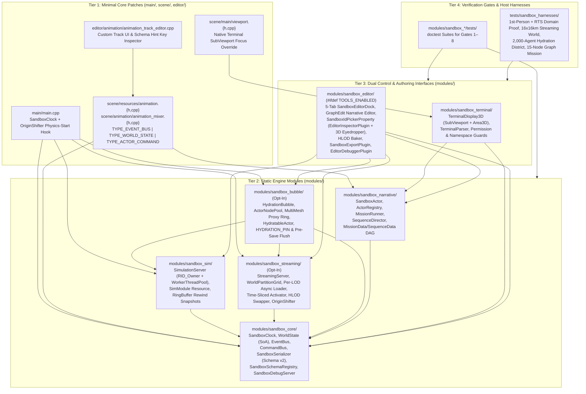

# Technical Review & Implementation Scope (v1.2): Modular 3D Sandbox Engine Framework

## 1. Cross-Reference Review: Draft v1.2 Specification vs. Local Codebase

We reviewed the updated Draft v1.2 specification ([SPEC.md](./SPEC.md)) against the **Godot Engine 4 Systems Capabilities Review** and the local C++ source tree.

### 1.1 Summary of Draft v1.2 Architectural Expansions
Compared to Draft v1.0, Draft v1.2 ([SPEC.md](./SPEC.md)) expands the framework from bounded 3D levels to **systemic open worlds and dense urban sandboxes** while overhauling **visual narrative authoring and schema-validated editor tooling**:

| v1.2 Expansion Area | Key Components Added / Upgraded | Verified Godot C++ Engine Primitives |
| :--- | :--- | :--- |
| **Schema Registry & Save Envelope v2 (`modules/sandbox_core`)** | `SandboxSchemaRegistry` `.tres` manifest + dynamic discovery merge; Schema v2 saves with `world_origin_64`, `streaming_cell_diffs`, and pre-save hydration flush. | `Resource`, `ProjectSettings`, `StreamPeerBuffer`, `JSON` (`core/io/resource_loader.h`). |
| **Spatial Partitioning, Per-LOD Streaming, HLOD, & Floating Origin (`modules/sandbox_streaming`)** | Opt-in `StreamingServer`, `WorldPartitionGrid` (Macro/Meso/Micro), 5-state async per-LOD loader, $\le 2.0\text{ ms}$ time-sliced activation (Jolt colliders first), dithered HLOD swapper, `OriginShifter` (`WorldPos64` / `REAL_T_IS_DOUBLE`). | `ResourceLoader::load_threaded_request` (`core/io/resource_loader.h`), `RS::instance_geometry_set_shader_parameter` (`servers/rendering/rendering_server.h`), `Node3D::reset_physics_interpolation` (`scene/3d/node_3d.h`). |
| **Simulation-to-Node Actor Hydration Bubble (`modules/sandbox_bubble`)** | Opt-in `HydrationBubble` (Tier 0 SoA $\leftrightarrow$ Tier 1 `MultiMesh` proxy ring $\leftrightarrow$ Tier 2 pooled `Node3D`), hysteresis ($R_{\text{in}} < R_{\text{out}}$), velocity-biased ellipsoid, `ActorNodePool`, `HydratableActor`, `HYDRATION_PIN`. | `RS::multimesh_set_buffer`, `RS::multimesh_set_visible_instances`, `RS::multimesh_instances_reset_physics_interpolation` (`servers/rendering/rendering_server.h`). |
| **Branching Mission & Sequence Graph Model (`modules/sandbox_narrative`)** | `MissionTransition` graph edges, `SequenceData` step DAG (sequential awaits, parallel forks, join barriers, conditional branches), `CondNot`, `ActionBranchCondition`, `_editor_graph_meta`. | `Tween::tween_await` (`scene/animation/tween.h`), `Animation` custom tracks (`scene/resources/animation.h`). |
| **Visual Narrative `GraphEdit`, Schema Pickers, & HLOD Baker (`modules/sandbox_editor`)** | 5-tab `EditorDock`, `GraphEdit` + `GraphNode` + `GraphFrame` canvas with live `sandbox:narrative_trace` highlighting, `SandboxIdPickerProperty` (`EditorInspectorPlugin` + 3D viewport eyedropper), `EditorExportPlugin` metadata stripper & strict schema gate, offline HLOD baker. | `GraphEdit`, `GraphEdit::arrange_nodes`, `GraphEdit::set_connection_activity` (`scene/gui/graph_edit.h`), `GraphNode` (`scene/gui/graph_node.h`), `EditorInspectorPlugin`, `EditorProperty` (`editor/inspector/editor_inspector.h`), `EditorExportPlugin` (`editor/export/editor_export_plugin.h`). |

---

### 1.2 Critical Technical Findings & Implementation Constraints for Draft v1.2

In addition to the 6 core findings from our v1.0 audit (baseline version `4.8.0-beta` vs `4.7.2`, `AnimationMixer::_update_caches()` node-resolution bypass, `AnimationTrackEdit` fixed `type_icons[9]` bounds, `WorldState` dual SoA layout, `sim_clock` spiral-of-death cap, and pre-handshake HTTP `403` validation on `SandboxDebugServer`), our codebase audit for **Draft v1.2** surfaced **5 new architectural constraints**:

> [!IMPORTANT]
> **Finding 7 (`sandbox_streaming`): Single-Subthread Scene Loading & True VRAM Unloading**
> 1. **ResourceLoader Thread Mode:** Because concurrent off-tree scene instantiation across multiple threads is unsafe due to shared global `Resource` mutation, `StreamingServer` must invoke `ResourceLoader::load_threaded_request(path, "", /*p_use_sub_threads=*/false, ResourceFormatLoader::CACHE_MODE_REUSE)` and perform `PackedScene::instantiate()` during the time-sliced `STAGED` $\rightarrow$ `ACTIVE_ATTACHED` main-thread phase.
> 2. **Strict Path-Only Manifests for VRAM Reclamation:** Godot's `ResourceCache` releases `Mesh` and `Texture2D` RIDs from `RenderingServer` only when the last `Ref<Resource>` drops to zero. `WorldPartitionManifest` and `WorldPartitionCell` must store strictly `String` paths (never cached `Ref<PackedScene>` properties on the manifest) and normalize/validate every path via `simplify_path()` to enforce `res://` prefixing and reject `..` or `user://` scripts (Security §5 & Gate #5).

> [!IMPORTANT]
> **Finding 8 (`sandbox_streaming` + `sandbox_bubble`): `MultiMesh` Physics Interpolation Reset on Origin Shift**
> When `OriginShifter` executes an atomic shift $-\Delta \vec{O}$ at the start of the physics tick (§3.8.5), calling `Node3D::reset_physics_interpolation()` on shifted scene nodes is necessary but not sufficient when `sandbox_bubble` is active: Tier 1 `MultiMesh` proxy instances are managed directly via `RenderingServer` RIDs without `Node3D` wrappers. `OriginShifter` must therefore also translate active Tier 1 `MultiMesh` buffers and invoke `RenderingServer::get_singleton()->multimesh_instances_reset_physics_interpolation(mm_rid)` so distant traffic and crowds do not streak across the frame during an origin shift.

> [!NOTE]
> **Finding 9 (`sandbox_editor`): `EditorInspectorPlugin` Coverage for `AnimationTrackKeyEdit` & 3D Eyedropper**
> 1. **Automatic Timeline Keyframe Picker Reuse:** When a designer selects a keyframe in `AnimationTrackEditor`, Godot pushes an `AnimationTrackKeyEdit` helper `Object` (`editor/animation/animation_track_editor.h`) to `InspectorDock`. By having `AnimationTrackKeyEdit::_get_property_list()` emit `PROPERTY_HINT_NONE` with hint strings `"sandbox_event_id"`, `"sandbox_world_state_key"`, and `"sandbox_actor_id"` for the three custom track types—and having `SandboxInspectorPlugin::can_handle(Object *)` accept both `AnimationTrackKeyEdit` and any `Node`/`Resource`—the exact same `SandboxIdPickerProperty` dropdown, fuzzy search, validation badges, and 3D eyedropper work identically in both the Inspector and the Animation timeline!
> 2. **3D Eyedropper Input Forwarding:** To pick a `SandboxActor` or `Marker3D` from the 3D Editor viewport in one click (§3.7.3), `SandboxEditorPlugin` calls `set_input_event_forwarding_always_enabled()` (`editor/plugins/editor_plugin.h`) and intercepts mouse clicks in `forward_3d_gui_input(Camera3D *, Ref<InputEvent>)` only while an eyedropper session is armed.

> [!CAUTION]
> **Finding 10 (`sandbox_editor`): `EditorExportPlugin::_customize_resource()` Must Duplicate Before Stripping `_editor_graph_meta`**
> In `editor/export/editor_export_plugin.h`, `_customize_resource(const Ref<Resource> &p_resource, const String &p_path)` passes the live `Resource` instance currently open in the Editor. Mutating `p_resource` in-place to strip `_editor_graph_meta` during an export would wipe the designer's in-memory node layout in the active Editor session. `SandboxExportPlugin::_customize_resource()` must call `p_resource->duplicate(false)`, clear `_editor_graph_meta` on the duplicate, and return the duplicate.

---

## 2. Updated Architecture & Component Dependency Graph (v1.2)

---

## 3. Rescoped 8-Phase Implementation Plan (Work Breakdown Structure)

### Phase 1: `modules/sandbox_core` & Tier 1 `SandboxClock` Main-Loop Hook
Establishes the core singletons, multi-clock scheduler, SoA state storage, `SandboxSchemaRegistry`, command/event routing, Schema v2 hardened serialization, and local debug server.

* **Files to Create (`modules/sandbox_core/`):**
  * `config.py`, `SCsub`, `register_types.{h,cpp}`
  * `sandbox_clock.{h,cpp}` — Decoupled `sim_clock` (pause, `step(n)`, $0\times\text{–}100\times$ speed, per-frame spiral-of-death budget), `physics_clock`, and `narrative_ui_clock` (unscaled real time).
  * `world_state.{h,cpp}` — Dual SoA storage:
    1. **Named Scalar SoA Channel Bank:** `AHashMap<StringName, uint32_t>` mapping keys (`&"weather.rain_intensity"`) to dense typed `LocalVector` columns (`double`, `int64_t`, `uint8_t`, `String`) for zero-boxing worker-thread access and timeline interpolation.
    2. **Entity SoA Tables:** `RID`-indexed multi-column contiguous buffers with `lock_structure()` during parallel `WorkerThreadPool` execution and single-threaded `commit_structural_changes()` post-tick.
  * `sandbox_schema_registry.{h,cpp}` — `SandboxSchemaRegistry : public Resource` loaded from `GLOBAL_GET("sandbox/schema/registry_path")`:
    * Stores typed descriptors for **WorldState Keys** (`key`, `value_type`, `default_value`, `range_hint`, `deprecated`, `description`), **EventBus Events** (`event_id`, `payload_schema`, `deprecated`, `description`), and **Actor / Tag / Archetype Catalogs**.
    * Implements `merge_dynamic_discovery()` (merges `SimModule::get_declared_schema()` and active scene `SandboxActor` / `Marker3D` IDs in editor builds) and `validate_reference(category, id, expected_type)`.
  * `event_bus.{h,cpp}` — Typed pub-sub router with thread-aware `emit()` (automatically routes off-main-thread calls into the mutex-guarded `dispatch_deferred` ring buffer), main-thread `flush_deferred()`, and inspection history ring buffer.
  * `command_bus.{h,cpp}` — Permission-tiered (`GUEST`, `USER`, `ADMIN`, `DEV` guarded by `#ifdef DEBUG_ENABLED`), type-checked command router with rate-limiting, 512-byte buffer cap, autocomplete metadata, and audit log.
  * `sandbox_serializer.{h,cpp}` — **Schema Envelope v2** (`.sbsav` binary via `StreamPeerBuffer` and `.json` structured text):
    * Enforces `allow_objects = false` across all deserializers; bans `ResourceLoader`/`ResourceSaver` for save files.
    * Serializes `schema_version = 2`, `world_origin_64`, `world_state`, `sim_modules` primitive blobs, `streaming_cell_diffs` sparse bitmasks, and `missions` progress.
    * Invokes `HydrationBubble::flush_active_actors_to_soa()` prior to saving so snapshots are independent of which actors are currently hydrated.
  * `sandbox_debug_server.{h,cpp}` — `#ifdef DEBUG_ENABLED` local `127.0.0.1` `TCPServer` inspecting raw HTTP upgrade requests for `Host` (blocking `0.0.0.0/8`), `Origin` allowlist, and per-session `CryptoCore::RandomGenerator` Bearer token before upgrading; terminates unauthorized handshakes with `HTTP/1.1 403 Forbidden`.
* **Tier 1 Patch (`main/main.cpp`):**
  * Hook `OriginShifter::check_and_shift()` at the start of the physics tick (prior to `iteration_prepare()`).
  * Hook `SandboxClock::advance(process_step)` to drive `SimulationServer::step(sim_delta)`, followed by main-thread `EventBus::flush_deferred()`, `HydrationBubble::update()`, and `StreamingServer::update()`.

---

### Phase 2: `modules/sandbox_sim` (`SimulationServer`, `SimModule`, & Rewind Ring Buffer)
Implements the multi-threaded simulation server and deterministic rewind snapshots.

* **Files to Create (`modules/sandbox_sim/`):**
  * `config.py`, `SCsub`, `register_types.{h,cpp}`
  * `sim_module.{h,cpp}` — Abstract `SimModule : public Resource` (`module_id`, `tick_rate_hz`, `priority`, `thread_safe_tick`, `on_init`, `on_tick`, `on_snapshot_write`, `on_snapshot_read`, optional `get_declared_schema()`).
  * `simulation_server.{h,cpp}` — Thread-safe `RID_Alloc<SimModuleInstance, true>` and `RID_Alloc<SimAgentSoA, true>`:
    * Dispatches `thread_safe_tick == true` modules across `WorkerThreadPool` by priority bucket; awaits every `TaskID`/`GroupID` before exiting the bucket (Invariant #1); forbids nested waits via `thread_local` guard (Invariant #2); locks SoA container sizing during parallel ticks (Invariant #3); flushes deferred events on the main thread (Invariant #4).
    * Built-in contiguous **Agent SoA Table** (`pos64`, `vel`, `rot`, `archetype_id`, `state_flags`, `health`, `hydration_tier`, `pin_mask`, `custom_blob`) shared with `HydrationBubble` for high-throughput traffic/crowd simulation.
    * Ring buffer of compressed `.sbsav` snapshots every $N$ ticks; `sim.rewind <ticks>` restores `WorldState` + `SimModule` blobs, triggers `HydrationBubble::resync_active_actors_from_soa()`, and emits `&"world_state_restored"`.

---

### Phase 3: `modules/sandbox_narrative` & Tier 1 `AnimationPlayer` Custom Tracks
Implements `SandboxActor`, `ActorRegistry`, native `AnimationPlayer` tracks, branching `MissionData` / `SequenceData` graphs, `SequenceDirector`, and `MissionRunner`.

* **Files to Create (`modules/sandbox_narrative/`):**
  * `config.py`, `SCsub`, `register_types.{h,cpp}`
  * `sandbox_actor.{h,cpp}` & `actor_registry.{h,cpp}` — `SandboxActor : public Node` (`actor_id`, `tags`, `control_lock_requested`, `teleport_requested`, `action_requested`), auto-registering with `ActorRegistry`.
  * `sandbox_condition.{h,cpp}` — `SandboxCondition : public Resource` (`evaluate()`) + built-ins: `CondStateEquals`, `CondStateRange`, `CondEventFired`, `CondAll`, `CondAny`, `CondNot` (using schema picker property hints).
  * `sequence_action.{h,cpp}`, `sequence_data.{h,cpp}`, & `sequence_director.{h,cpp}`:
    * `SequenceStep` / `SequenceAction` (`step_uuid`, `wait_for_completion`, `next_steps: PackedStringArray`, `branch_true_steps`, `branch_false_steps`).
    * Built-in actions: `ActionPlayAnimation`, `ActionSetState`, `ActionEmitEvent`, `ActionRunCommand`, `ActionLockActor`, `ActionBranchCondition`, `ActionWaitEvent`, `ActionBlendCamera`.
    * `SequenceData : public Resource` holding `sequence_id`, `entry_step_uuid`, `steps: TypedArray<SequenceAction>`, and `_editor_graph_meta: Dictionary`.
    * `SequenceDirector : public Node` executing the step DAG across sequential awaits, parallel forks, join barriers, and conditional branches using `SandboxClock` narrative delta and `Tween::tween_await()`, streaming live step states over `EngineDebugger` (`sandbox:narrative_trace`).
  * `mission_data.{h,cpp}` & `mission_runner.{h,cpp}`:
    * `ObjectiveData : public Resource` (`objective_id`, `title`, `required`, `complete_condition`, `fail_condition`).
    * `MissionTransition : public Resource` (`from_objective_id`, `to_objective_id`, `on_fail: bool`, `condition: Ref<SandboxCondition>`).
    * `MissionData : public Resource` (`mission_id`, `objectives`, `transitions`, `on_start_sequence`, `on_complete_sequence`, `_editor_graph_meta: Dictionary`).
    * `MissionRunner` singleton evaluating active mission DAGs on `EventBus` / `WorldState` updates and emitting `sandbox:narrative_trace` debugger packets.
* **Tier 1 Patches (`scene/resources/animation.{h,cpp}`, `scene/animation/animation_mixer.{h,cpp}`, `editor/animation/animation_track_editor.cpp`):**
  * Add `TYPE_EVENT_BUS`, `TYPE_WORLD_STATE`, `TYPE_ACTOR_COMMAND` to `Animation::TrackType` and `Animation::get_cache_type()`.
  * Bypass `parent->get_node_and_resource()` in `AnimationMixer::_update_caches()` for the 3 global track types.
  * Expand `type_icons[12]` in `AnimationTrackEdit::_get_key_type_icon()`, add menu items to `AnimationTimelineEdit`, and emit schema hint strings (`"sandbox_event_id"`, `"sandbox_world_state_key"`, `"sandbox_actor_id"`) in `AnimationTrackKeyEdit::_get_property_list()`.

---

### Phase 4: `modules/sandbox_streaming` (Opt-In Spatial Partitioning, Per-LOD Async Loader, HLOD, & `OriginShifter`)
Implements open-world streaming, VRAM reclamation, time-sliced activation, HLOD cross-fading, and floating-origin coordinate management.

* **Files to Create (`modules/sandbox_streaming/`):**
  * `config.py`, `SCsub`, `register_types.{h,cpp}`
  * `world_partition_manifest.{h,cpp}` — `WorldPartitionLayer` (Macro $512\text{ m}$, Meso $128\text{ m}$, Micro $32\text{ m}$, `load_radius`, `evict_radius`) and `WorldPartitionCell` (`cell_id`, `layer`, `grid_coords`, `hlod_impostor_path`, `mid_mesh_path`, `high_scene_path`, `collision_bundle_path`).
    * Strictly validates all paths on registration: must normalize to `res://` with no `..`, `user://`, or script extensions (returns `ERR_INVALID_DATA` on violation).
  * `streaming_invoker.{h,cpp}` — `StreamingInvoker : public Node3D` tracking smoothed velocity $\vec{v}$ and lookahead horizon $\Delta t_{\text{lookahead}}$ ($2.0\text{ s}\text{–}4.0\text{ s}$).
  * `streaming_server.{h,cpp}` — Opt-in singleton (`set_enabled(bool)`):
    * Evaluates active invokers + cutscene pins against `WorldPartitionGrid`.
    * Manages the 5-state per-cell machine: `UNLOADED` $\leftrightarrow$ `LOADING_ASYNC` $\leftrightarrow$ `STAGED` $\leftrightarrow$ `ACTIVE_ATTACHED` $\leftrightarrow$ `EVICTING`.
    * Schedules async loads via `ResourceLoader::load_threaded_request(..., false)` ordered by the priority formula:
      $$\text{Priority} = w_1 \cdot \frac{1}{\max(d, 1.0)} + w_2 \cdot \max(0, \hat{f} \cdot \hat{d}_{\text{cell}}) + w_3 \cdot \text{PinWeight}$$
    * **Time-Sliced Main-Thread Activator ($B_{\text{stream}} \le 2.0\text{ ms}$):** Unpacks `STAGED` cells across frames within `budget_usec`: (1) Jolt static collision shapes first, (2) visual `Node3D` sub-batches, (3) dithered HLOD cross-fade (`hlod_fade` instance shader parameter over $0.2\text{ s}\text{–}0.35\text{ s}$), (4) emits `&"stream_cell_activated"`.
    * **True RAM/VRAM Eviction:** Detaches cell nodes, frees Jolt bodies, drops all `Ref<Resource>` handles so `RenderingServer` frees mesh/texture RIDs, and records sparse cell diffs (`streaming_cell_diffs` bitmasks for destroyed/mutated props).
    * Registers `CommandBus` commands: `stream.stats`, `stream.budget`, `stream.pin`, `stream.unpin`, `stream.hlod_force`.
  * `origin_shifter.{h,cpp}` — `OriginShifter` singleton:
    * Stores 64-bit authoritative `WorldPos64` (`Vector3i` $512\text{ m}$ sector + `Vector3` local offset, or `double[3]`).
    * When compiled with `precision=single` (`#ifndef REAL_T_IS_DOUBLE`) and the primary invoker drifts beyond $R_{\text{shift}}$ ($2048\text{ m}$), executes an atomic grid-snapped shift $-\Delta \vec{O}$ at the start of the physics tick: translates registered root `Node3D`s, active streamed cells, and `HydrationBubble` Tier 1/2 entities, calls `reset_physics_interpolation()` on all shifted `Node3D`s and `RS::multimesh_instances_reset_physics_interpolation()` on Tier 1 `MultiMesh` RIDs, and emits `&"origin_shifted"`.
    * Automatically acts as a no-op pass-through when compiled with `precision=double` (`#ifdef REAL_T_IS_DOUBLE`).

---

### Phase 5: `modules/sandbox_bubble` (Opt-In Simulation-to-Node Actor Hydration Bubble)
Bridges `SimulationServer` SoA agents with pooled `SceneTree` actors and `MultiMesh` GPU proxies.

* **Files to Create (`modules/sandbox_bubble/`):**
  * `config.py`, `SCsub`, `register_types.{h,cpp}`
  * `hydratable_actor.{h,cpp}` — `HydratableActor : public Node` (`archetype_id`, `hydrate_radius = 140.0`, `dehydrate_radius = 165.0`, `bound_rid`, signals `hydrated(rid, initial_state)` and `dehydrating(rid, out_state)`, `set_pinned(pinned, reason)`).
  * `actor_node_pool.{h,cpp}` — `ActorNodePool`:
    * Pre-warms configurable counts of inactive `Node3D` prefabs per `archetype_id` at startup (`PROCESS_MODE_DISABLED`, hidden, detached from Jolt space).
    * Zero runtime `instantiate()` or `queue_free()` calls during steady-state traversal; supports configurable pool-exhaustion overflow policy (`KEEP_TIER1_PROXY` vs. `RECYCLE_FARTHEST_UNPINNED`).
  * `hydration_bubble.{h,cpp}` — Opt-in `HydrationBubble` singleton:
    * Evaluates agent distances against velocity-biased invoker ellipsoids with hysteresis ($R_{\text{in}} < R_{\text{out}}$).
    * **Tier 0 (Abstract SoA, $d > R_{\text{proxy}}$):** Pure C++ SoA struct ticked in `SimulationServer`.
    * **Tier 1 (Batched Proxy Ring, $R_{\text{out}} < d \le R_{\text{proxy}}$):** Packs local 32-bit transforms into per-archetype float buffers and uploads directly via `RenderingServer::get_singleton()->multimesh_set_buffer()` and `multimesh_set_visible_instances()`.
    * **Tier 2 (Hydrated Live Actor, $d \le R_{\text{in}}$):** Time-sliced main-thread hydration/dehydration budget (max $4$ hydrations and $6$ dehydrations or $\le 1.5\text{ ms}$/frame); claims/returns `ActorNodePool` nodes, calls `reset_physics_interpolation()`, performs lossless SoA state round-trip (transform, velocity, health, damage, custom byte blob), and respects `HYDRATION_PIN`.
    * Implements `flush_active_actors_to_soa()` (for pre-save snapshot flush) and `resync_active_actors_from_soa()` (for `sim.rewind` and save loading).
    * Registers `CommandBus` commands: `bubble.stats`, `bubble.radius`, `bubble.pin`, `bubble.unpin`.

---

### Phase 6: `modules/sandbox_terminal` & Tier 1 `Viewport` Native Terminal Focus
Implements diegetic 3D monitors with rendering guardrails, 3D-to-2D raycast synthesis, captured-mouse center raycasting, permission enforcement, and native `Viewport` focus routing.

* **Tier 1 Patch (`scene/main/viewport.{h,cpp}`):**
  * Add `terminal_focus_viewport_id` and `terminal_focus_release_callback` on `Viewport` (`set_terminal_focus_viewport`, `clear_terminal_focus_viewport`).
  * Route keyboard, shortcut, and mouse-wheel events directly into the focused `SubViewport` in `Viewport::push_input()`, releasing focus on `ui_cancel`.
* **Files to Create (`modules/sandbox_terminal/`):**
  * `config.py`, `SCsub`, `register_types.{h,cpp}`
  * `terminal_parser.{h,cpp}` — CLI tokenizer, typed literal parser, history ring buffer, and `CommandBus` autocomplete provider.
  * `terminal_display_3d.{h,cpp}` — `TerminalDisplay3D : public Node3D`:
    * Standalone `SubViewport` (no `SubViewportContainer` wrapper), enforcing `disable_3d = true`, minimum $256 \times 256$ resolution guard (FSR2 safety), MSDF font rendering, sRGB-aware CRT/surface shader (`source_color`), and distance/frustum `UPDATE_DISABLED` throttling.
    * 3D-to-2D raycast coordinate synthesis (`quad.global_transform.affine_inverse()`), explicit camera-center raycasting when `Input::get_mouse_mode() == Input::MOUSE_MODE_CAPTURED`, `SandboxActor` control lock engagement, and per-terminal `PermissionLevel` + `allowed_namespaces` filtering.

---

### Phase 7: `modules/sandbox_editor` (5-Tab `EditorDock`, `GraphEdit` Narrative Canvas, Schema ID Pickers, HLOD Baker, & Export Plugin)
Implements the complete visual authoring, schema validation, baking, and live debugging suite.

* **Files to Create (`modules/sandbox_editor/`):**
  * `config.py`, `SCsub`, `register_types.{h,cpp}`
  * `sandbox_editor_dock.{h,cpp}` — `SandboxEditorDock : public EditorDock` hosting 5 tabs:
    1. **Asset Browser Tab:** Scans `res://` for `SimModule`, `MissionData`, `SequenceData`, `SandboxSchemaRegistry`, and `WorldPartitionManifest` `.tres` assets.
    2. **Narrative Flow Graph Tab (`sandbox_narrative_graph_editor.{h,cpp}`):**
       * Native `GraphEdit` canvas directly bound to the inspected `MissionData` or `SequenceData` `.tres` resource.
       * Enforces typed ports via `add_valid_connection_type()`: Port `0` (Execution Flow — White/Blue), Port `1` (Condition Logic — Amber), Port `2` (Sequence Reference — Purple).
       * Custom `GraphNode`s: `MissionEntryNode`, `ObjectiveNode`, `ConditionNode`, `CombinatorNode` (`ALL`/`ANY`/`NOT`), auto-discovered `SequenceActionNode`s (solid blocking wire vs. dashed parallel wire), `WaitEventNode`, `BranchNode`, and `CommentFrameNode` (`GraphFrame`).
       * Full `EditorUndoRedoManager` integration, deterministic `_editor_graph_meta` layout dictionary sorted by UUID, **Auto-Arrange (Layered DAG)** button (`GraphEdit::arrange_nodes()`), and live runtime execution highlighting (`green` active, `amber` awaiting, `cyan` completed, `red` failed) driven by `sandbox:narrative_trace`.
    3. **Live WorldState & Streaming Inspector Tab:** Displays real-time SoA variables, active missions, `SimModule` tick timings (`usec/tick`), loaded cell heatmaps, VRAM residency, and `HydrationBubble` Tier 0/1/2 counts.
    4. **HLOD Baker Utility Tab (`sandbox_hlod_baker.{h,cpp}`):** Uses **Option A (Combined 3D Proxy Mesh + Texture Atlas)**: partitions tagged static scene geometry into `WorldPartitionCell` `.scn` bundles and merges static cell geometry on the CPU via `SurfaceTool` / `ArrayMesh` paired with a rect-packed `Image` albedo/normal/ORM texture atlas (reducing per-cell static draw calls to 1 without requiring 2D billboard impostor snapshot passes).
    5. **Command Console Tab:** Interactive CLI with `CommandBus` autocomplete executing commands over `sandbox:cmd`.
  * `sandbox_inspector_plugin.{h,cpp}` — `SandboxInspectorPlugin : public EditorInspectorPlugin` & `SandboxIdPickerProperty : public EditorProperty`:
    * Intercepts `"sandbox_world_state_key[:type]"`, `"sandbox_event_id"`, `"sandbox_actor_id"`, and `"sandbox_marker_id"` across `Resource`, `Node`, and `AnimationTrackKeyEdit`.
    * Renders searchable fuzzy dropdown (`PopupPanel` + `LineEdit` + namespace-grouped `Tree` with `Variant.Type` badges and tooltips), inline validation badges (missing key, `deprecated`, or type mismatch), **"Add to Schema Registry"** button in Permissive mode, and inline **Pick from 3D Scene (Eyedropper)** + **Focus in 3D Viewport** buttons for actor/marker IDs.
  * `sandbox_export_plugin.{h,cpp}` — `SandboxExportPlugin : public EditorExportPlugin`:
    * In `_customize_resource()`, duplicates `MissionData` and `SequenceData` resources and strips `_editor_graph_meta` on release exports.
    * In `_export_begin()`, when `GLOBAL_GET("sandbox/schema/strict_mode")` is enabled, audits all `MissionData`, `SequenceData`, and `Animation` `.tres` files against `SandboxSchemaRegistry` and aborts export if broken references exist.
  * `sandbox_editor_debugger.{h,cpp}` — `SandboxEditorDebuggerPlugin : public EditorDebuggerPlugin` paired with runtime `EngineDebugger` capture (`sandbox:cmd`, `sandbox:telemetry`, `sandbox:narrative_trace`).
  * `sandbox_editor_plugin.{h,cpp}` — Registers the 5-tab `EditorDock`, `SandboxInspectorPlugin`, `SandboxExportPlugin`, `SandboxEditorDebuggerPlugin`, and 3D viewport eyedropper input forwarding.

---

### Phase 8: Verification Gates & Test Harnesses (All 8 Acceptance Criteria in §6)
Implements automated C++ `doctest` suites under `modules/sandbox_*/tests/` and test harness scenes verifying all 8 gates:

| Gate | Verification Target | Automated Test Suite & Acceptance Criteria Checked |
| :--- | :--- | :--- |
| **Gate 1** | **Multi-Clock Isolation Test** | `modules/sandbox_core/tests/test_sandbox_clock.h`: `sim_clock` at $50\times$ and $0\times$ (paused); verifies Jolt 60 Hz stability, audio playback scale $1.0$, and terminal latency $< 16.6\text{ ms}$. |
| **Gate 2** | **Thread Safety & Leak Audit** | `modules/sandbox_sim/tests/test_simulation_server.h`: $10,000$ consecutive `SimulationServer` ticks across $8$ concurrent `SimModule`s on `WorkerThreadPool` with zero data races, zero `ERR_BUSY` aborts, and zero leaked task handles. |
| **Gate 3** | **Domain Agnosticism Proof** | `modules/sandbox_narrative/tests/test_domain_agnosticism.h`: Mounts identical `MissionData`, custom-track `Animation`, and `TerminalDisplay3D` onto (a) a 1st-person `CharacterBody3D` rig and (b) an RTS top-down camera rig via `SandboxActor`. |
| **Gate 4** | **3D Terminal Legibility & Performance Gate** | `modules/sandbox_terminal/tests/test_terminal_display_3d.h`: $4$ simultaneous `TerminalDisplay3D` monitors; verifies MSDF font settings, `disable_3d = true`, min $256 \times 256$ FSR2 guard, captured-mouse center raycast, and `ui_cancel` focus release. |
| **Gate 5** | **Security Verification** | `modules/sandbox_core/tests/test_sandbox_security.h`: Rejects crafted `Object`-payload save files (`ERR_INVALID_DATA`); rejects `WorldPartitionManifest` paths with `../` or `user://` scripts; terminates unauthenticated/mismatched-`Origin` WebSocket handshakes with HTTP `403 Forbidden`; verifies `#ifndef DEBUG_ENABLED` strips debug sockets and `DEV` commands. |
| **Gate 6** | **High-Speed Open-World Streaming & Floating Origin Gate** | `modules/sandbox_streaming/tests/test_streaming_server.h`: Traverses a $16\text{ km} \times 16\text{ km}$ partitioned world at $90\text{ m/s}$ across $\ge 4$ `OriginShifter` thresholds ($R_{\text{shift}} = 2048\text{ m}$); verifies activation $\le 2.0\text{ ms/frame}$, VRAM reclamation on cell eviction, gapless HLOD cross-fades, and `reset_physics_interpolation()` on origin shifts. |
| **Gate 7** | **Hydration Bubble SoA-to-Node Stress Gate** | `modules/sandbox_bubble/tests/test_hydration_bubble.h`: Simulates $2,000$ SoA agents while moving an invoker through a dense district; verifies $100\%$ `ActorNodePool` reuse (zero runtime `instantiate()`/`queue_free()`), zero $R_{\text{in}}/R_{\text{out}}$ boundary oscillation, intact state round-trip (damage, health, velocity, `HYDRATION_PIN`) across $500$ cycles, and lossless save/load after pre-save hydration flush. |
| **Gate 8** | **Visual Authoring & Schema Validation Gate** | `modules/sandbox_editor/tests/test_sandbox_editor.h`: Authors a $15$-node branching `MissionData` + `SequenceData` graph via `GraphEdit` (`CondAll`/`CondAny`/`CondNot`, parallel `SequenceAction` forks, fail transitions); verifies `EditorUndoRedoManager` rollback, `_editor_graph_meta` stripping on release export, live `sandbox:narrative_trace` highlighting, `SandboxIdPickerProperty` fuzzy search/badges, strict-mode export gate failure on broken keys, and 3D eyedropper picking. |
